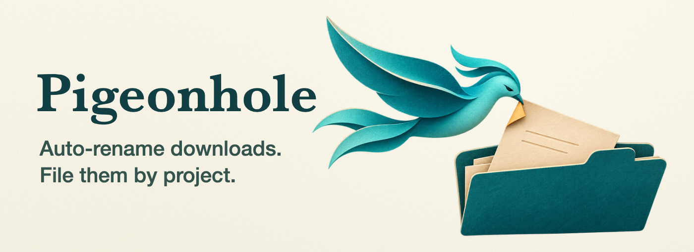
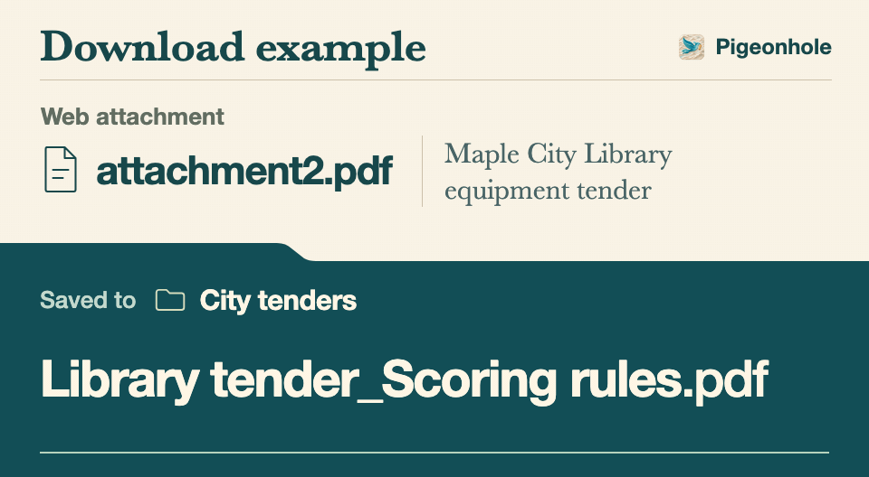
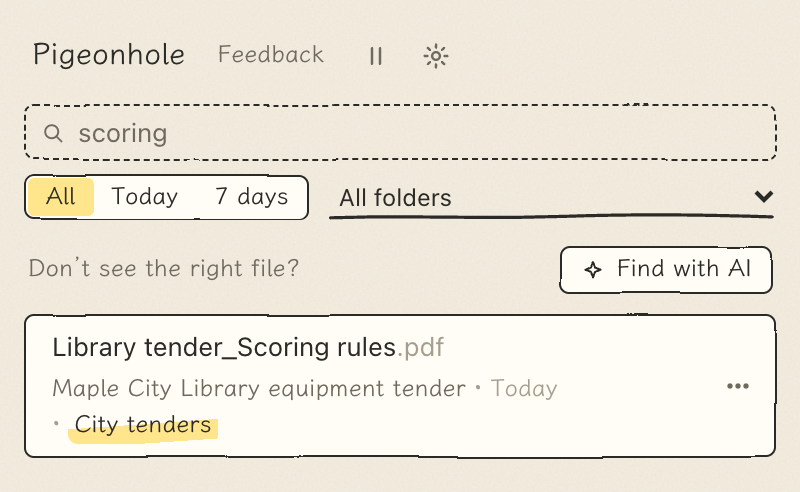
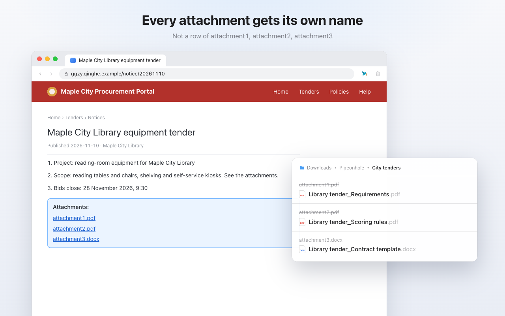
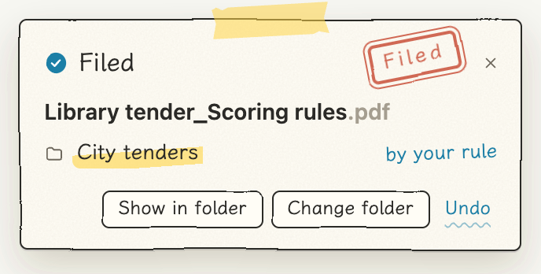
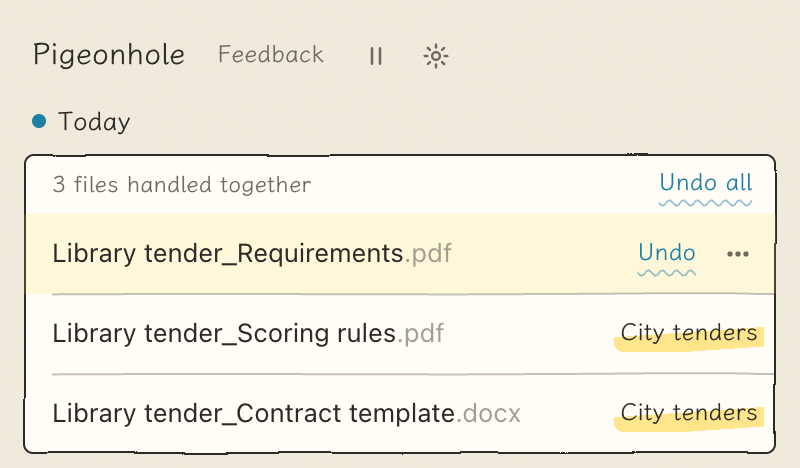
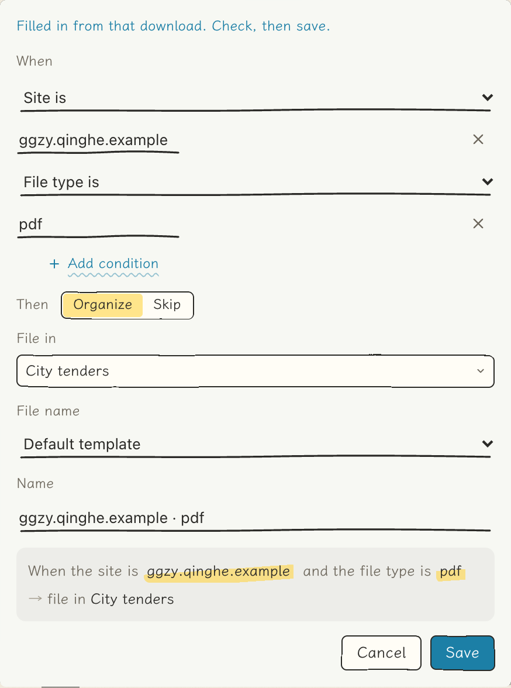
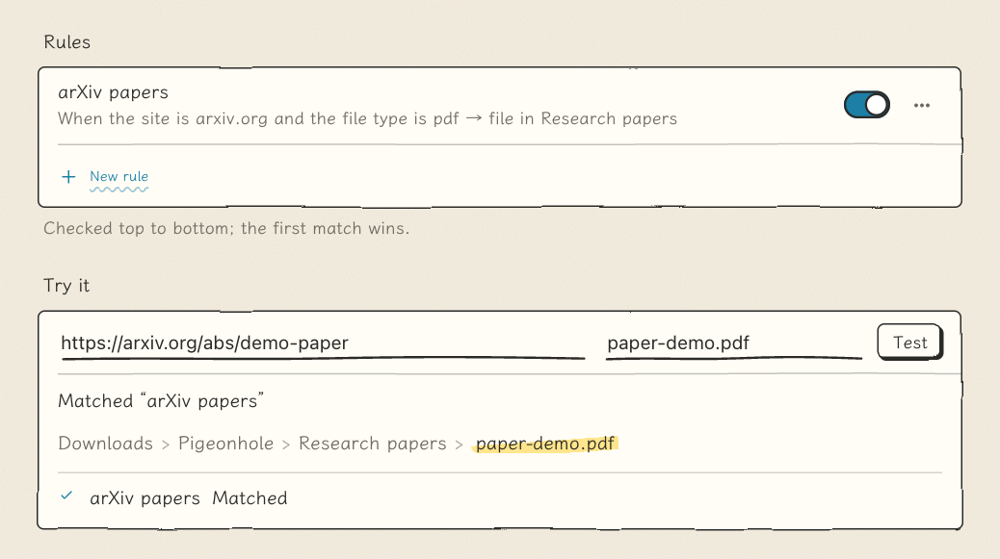

<a href="README.md" lang="zh-CN">简体中文</a> · <strong>English</strong>

<h1 align="center"></h1>

Pigeonhole is a Chrome extension that gives downloads readable names using clues from the source page. It files papers, attachments and design assets into project folders using your rules, tab groups or AI suggestions.

 
No account required · Try the built-in AI or connect your own provider

<a href="#features">Features</a> · <a href="#download-search-preview">0.2.0 preview</a> · <a href="#product-tour">Product tour</a> · <a href="#filing-rules">Filing rules</a> · <a href="#your-first-download">Your first download</a> · <a href="#faq">FAQ</a>

## Features

| When you download… | What Pigeonhole can do |
| --- | --- |
| Several files all called “Attachment” from one page | Turn on **Page snippets** and grant site access. Pigeonhole can use the text around each link to tell the requirements, scoring rules and contract template apart. |
| Material for one project from several sites | Tie a project to a browser tab group, set a filing rule, or use an AI suggestion. If no project fits, Pigeonhole can file by type or use the *Other* folder. |
| Files that must keep a supplier's original reference number | Add the site to **Keep names from**. Its files can still go to the project folder with their original names intact. |
| A file lands in the wrong project | Turn on **Show download cards on the page** and grant site access. The card shows progress, the new filename and its destination. Choose **Change folder** or **Undo** from the page where you downloaded it. |
| A project already has a folder on your computer | Edit the project, select **Use a folder on your computer…**, then pick the existing directory. For example, make the folder you already use for exhibition artwork the destination for that project. |
| Something you need to find or move later | Open Pigeonhole from the toolbar to see the saved name, project and available undo actions. If you like where it landed, you can make a rule from that download. |

<picture>
  <source media="(prefers-reduced-motion: reduce)" srcset="media/en/download-demo-still.png">
  
</picture>

## Download search preview

**Version 0.2.0 is a release candidate.** It lets you find downloads Pigeonhole has handled using clues from the source page. As of November 25, 2026, the [Chrome Web Store](https://chromewebstore.google.com/detail/pigeonhole/ikjdcjgnlbealhahlogjidahhhlbcdhp?hl=en) offers version 0.1.2.

To find the scoring sheet from the library tender above, open **Recent** in the toolbar panel and type `scoring`. For a different tender, you might only remember downloading a parking PDF last week. Try `last week PDF parking`. The date and file type become filters, while “parking” matches the filename, source page title or saved link text. Keyword searches run on your device. You can also filter by the file’s last confirmed folder.

- **Find attachments from a page you revisit.** Open the panel on that page. **Downloaded from this page** lists the downloads Pigeonhole has recorded there.
- **Describe a file with Find with AI.** Select the button and confirm on first use to send your description and up to 30 locally selected summaries. The AI can suggest up to three matches and explain its choices. Pigeonhole excludes records from sites where you’ve disabled AI. The request omits file contents, full URLs and local paths.
- **Open a match in your browser.** Use **Open in browser** to view a PDF, common image, plain text file or supported audio or video file read-only. This also works after a move if Pigeonhole can locate the file and has permission to read its folder.
- **Check where a large file actually landed.** External filing verifies large files in chunks. The record distinguishes a completed move from a file still in Downloads or one whose location needs checking.

**In the development version**, you can describe a rule in a sentence, such as “File arXiv papers in Thesis/Papers.” Check the conditions and destination the AI drafts before saving. You can also read the release history in settings and choose whether to see update notices in the toolbar panel. These features haven’t reached the 0.2.0 candidate yet.

## Product tour

The screenshots use sample files and projects. Select an image to see it at full size.

### Give each attachment on a page its own name

The Maple City library tender links to two PDFs and a Word document. The second link is called `attachment2.pdf`, but the words around it identify the scoring rules. Pigeonhole can keep that distinction in the filename. When you review the bids, search *City tenders* for “Scoring rules” to find the right PDF.

See the three original attachments and their saved names

### Change the destination as the download finishes

In **General**, turn on **Show download cards on the page** and grant site access when prompted. When the download finishes, the card shows the saved name and destination. In this example, the scoring sheet went to *City tenders*. Choose **Show in folder** to open its location or **Change folder** to pick another project. The toolbar panel also keeps a record when the page cannot show a card.

If your project already has a directory on your computer, select **Change folder → Choose a folder on your computer…**. Chrome needs access to both the folder Pigeonhole manages in Downloads and the destination folder. The file stays in the managed Downloads folder until you grant access.

See the on-page download card and its Change folder button

### Find a file after closing its source tab

Open Pigeonhole from the Chrome toolbar to see your recent downloads. All three tender documents went to *City tenders*. Use **Undo** on an individual entry when available, or **Undo all** for the batch. Chrome may ask for folder access when a file needs to move.

### Turn a good filing decision into a rule

A procurement project can run for weeks. On a download that went to the right folder, choose **More → Always do this**. Pigeonhole pre-fills the source, file type and project. In this example, PDFs from the procurement site will go to *City tenders*. Other file types can follow their own rules. Check the conditions, then select **Save**.

See the source, file type and project in the rule editor

## Filing rules

Start in **Projects & Rules**. Create a project such as *Research papers*. You can enter a project folder up to two levels deep, such as `Thesis/Papers`. You can associate sites and tab groups with the project and add a short description for the AI.

Choose **New rule**. **Add condition** lets you require more than one match, such as a particular website **and** a PDF file. Rules are checked from top to bottom. Use **Move up** or **Move down** to give a more specific rule priority.

| What you're working on | A rule to try |
| --- | --- |
| **A literature review.** Collect papers without filing every download from the same site. | Set **Site is** to `arxiv.org` and **File type is** to `pdf`. Choose your research project under **File in**. |
| **An exhibition or design project.** Reference images, floor plans and print specs come from different sites. | Put those pages in a *Spring exhibition* tab group, then use **Tab group is** to send downloads from the group to one project. |
| **Monthly reports.** You want to find a CSV by its subject and date. | Match pages whose title or URL contains *monthly ridership*. Choose your reporting project and select **Date first** under **File name** for that rule. |
| **A bid or client delivery.** The recipient expects the original document numbers. | Match the source site, choose the destination project, then select **Keep name**. This also works for application forms that must be returned with their original identifiers. |

### Test a rule before downloading

Open **Projects & Rules → Try it**. Pick a recent download or enter a URL and filename, then select **Test**. In the screenshot, `paper-demo.pdf` matches the *arXiv papers* rule and would land in `Downloads/Pigeonhole/Research papers`. You can adjust the conditions or rule order and try again without downloading anything.

What if two projects use the same website?

Suppose you download readings for both Statistics and Urban Planning from one university site. Make a tab group and a matching rule for each course. If you also have a rule for the entire site, move the course rules above it. Download one file from each tab group and check the destinations in the toolbar panel.

## Your first download

1. Install Pigeonhole from the Chrome Web Store. Open a course page or notice with several attachments. To distinguish files linked from the same page, turn on **Page snippets** in settings and grant access when Chrome asks.
2. Click a download link as usual. Try one with a generic name such as `file.pdf` so the change is easy to spot.
3. Open Pigeonhole in your toolbar to see the saved name and destination. To send similar files there in the future, create a rule from that entry.

## FAQ

<strong>Can I preview names for papers, notices and images?</strong>

Yes. In **Naming & AI**, switch between the **Paper**, **Notice** and **Image** samples to compare the original name with the result. A paper's title can give an identifier-only PDF a readable name. A work's title can do the same for a camera filename or an image called `image.png`.

<strong>What does the AI see? Does it receive my files?</strong>

File contents are never uploaded. Naming and filing suggestions can use the page title, cleaned URL and original filename. If you enable **Page snippets** and grant access, text near the download link and a short excerpt from the start of the page can also be sent to the AI. Settings and download history stay in your browser. You can turn off anonymous usage statistics in settings. [Pigeonhole privacy policy](https://pigeonhole.tmlab.top/privacy?lang=en)

<strong>Can I pause the extension or get fewer notifications?</strong>

In **General**, set **Notifications** to **Only to review**. If you're downloading a batch that needs no organizing, choose **Pause 1 hour** or **Pause for today**.

<strong>Do I need an account or an API key? Can I use my own provider?</strong>

You can try the built-in AI without an account or an API key. To use your own compatible AI provider, enter its API key, endpoint and model in settings. Your provider's fees and limits apply.

This repository contains the source for [Pigeonhole Lite](docs/lite.en.md), and the full extension is available from the [Chrome Web Store](https://chromewebstore.google.com/detail/pigeonhole/ikjdcjgnlbealhahlogjidahhhlbcdhp?hl=en).
