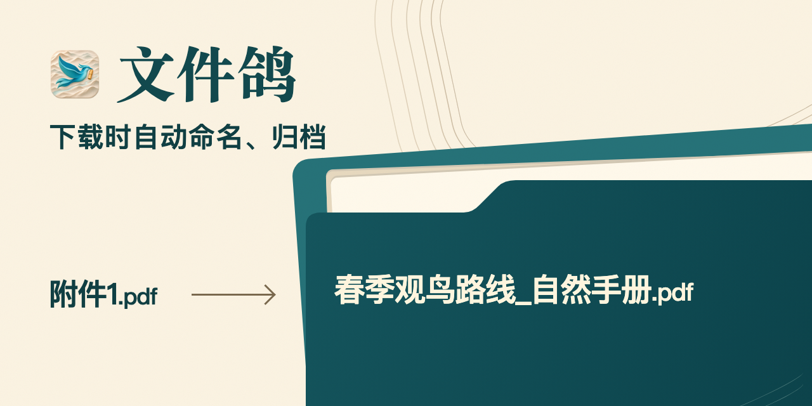
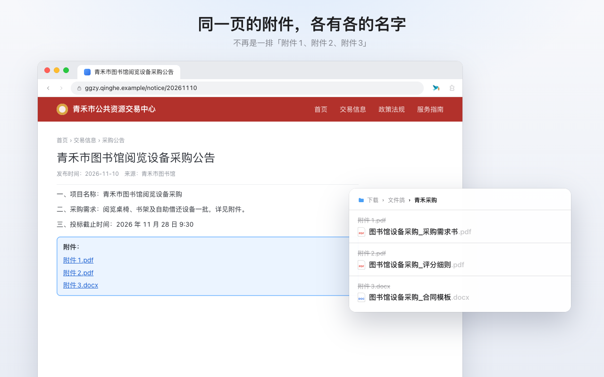

# 文件鸽 · 下载时自动命名，按项目归档

开会时要找「评分细则」，下载文件夹里却只有 `附件1.pdf`、`附件2.pdf`。文件鸽是一款 Chrome 下载整理扩展。它在你点击下载时，结合网页上关于这份附件的线索，给文件起个能搜到的名字，再放进对应的项目文件夹。

**[在 Chrome 应用商店安装文件鸽](https://chromewebstore.google.com/detail/pigeonhole/ikjdcjgnlbealhahlogjidahhhlbcdhp?hl=zh-CN)** · 无需注册或填写 API Key，公测期间内置 AI 每日限量免费。

## 同一页的三个附件，也能分别命名

一份图书馆采购公告，底下挂着两份 PDF 和一份 Word。只用公告标题，三份文件会很难区分。允许文件鸽读取附件附近的少量文字后，它能结合每个下载链接的上下文，把它们分别命名为「采购需求书」「评分细则」「合同模板」。下次搜「评分细则」，就能直接找到要打开的那一份。

## 让浏览器里的项目，也成为下载文件的去向

如果你在准备一次展览，可以把场地平面图、印刷规格和海报素材的网页放进「春季展览」标签组。即使文件来自三个网站，文件鸽也可以依据标签组，把它们归进同一个项目文件夹。对经常下载的资料，你可以设置自己的归档规则，也可以让 AI 建议去向。没有匹配项目时，文件鸽会按来源网站归类。需要移动文件时，浏览器会请你授权目标文件夹。

记得下载过一份文件，却想不起放在哪？点开扩展面板就能看最近的处理记录。文件名或去向不合适，可以从记录里撤销改名或更换文件夹。

## 使用场景

| 手头的事 | 文件鸽能帮上的忙 |
| --- | --- |
| **做文献综述、准备课程** | 从论文详情页保存以编号命名的 PDF 时，让文件名带上题目。几周后写引用可以按题目搜。同一门课的讲义、习题和参考论文，还可以借助课程标签组集中保存。 |
| **跟进投标、采购或客户项目** | 一份公告常带着技术要求、报价表和合同模板。让同页附件分别带上材料名称，再按项目归档，交付前更容易找齐。 |
| **做设计、视频或 AI 创作** | 下载配图、参考照片、分镜素材时，`image.png` 或相机流水号很难辨认。作品详情页的标题能为命名提供线索，项目标签组还能把从不同素材站收集的文件放在一起。 |
| **做月报、收发票、整理数据** | 如果导出页标题里有月份或事项，就能借它给 `download.csv` 或纯数字票据名补上含义。之后按「四月客流」或行程名称查找，不必逐个打开。 |
| **办手续、投实习、准备旅行** | 一次出行可能要从不同网站下载报名表、材料清单和路线图。放在同一个行程标签组里，出门前就知道去哪找这一套资料。 |

## AI 会读取我的文件吗？

文件内容不会上传。AI 根据网页标题、处理过的网址和原文件名辅助命名与归档，获得授权后还可以参考附件附近的少量文字。设置和处理记录保存在本机。你也可以接入自己选用的兼容 AI 服务，或在设置中关闭匿名使用统计。

本仓库仅公开[文件鸽 Lite 版](docs/lite.md)的源码，完整版可从 [Chrome 应用商店下载安装](https://chromewebstore.google.com/detail/pigeonhole/ikjdcjgnlbealhahlogjidahhhlbcdhp?hl=zh-CN)。
