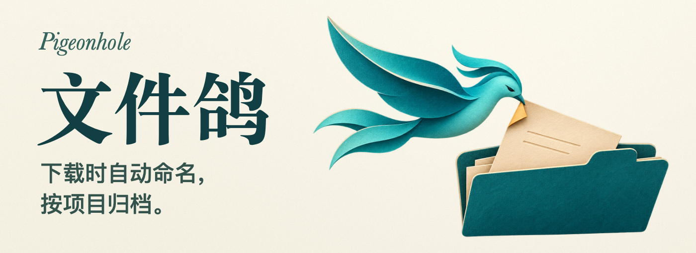
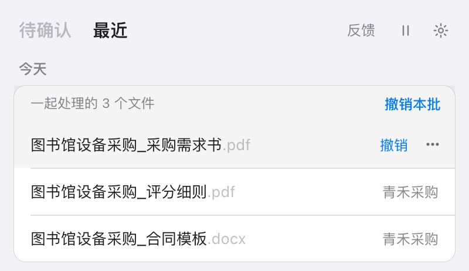
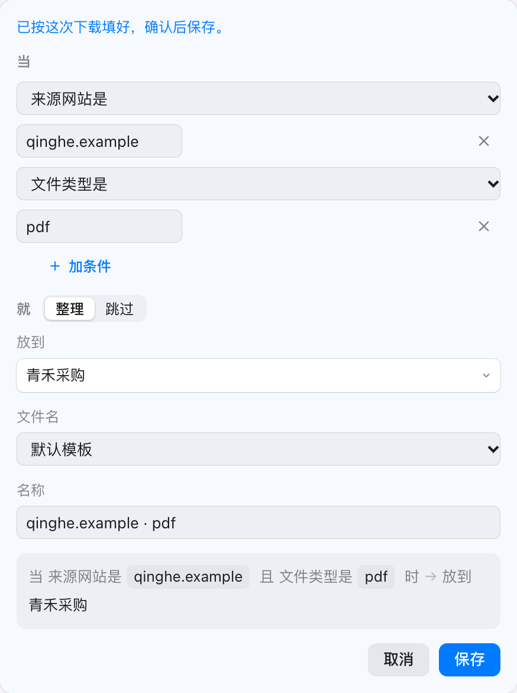
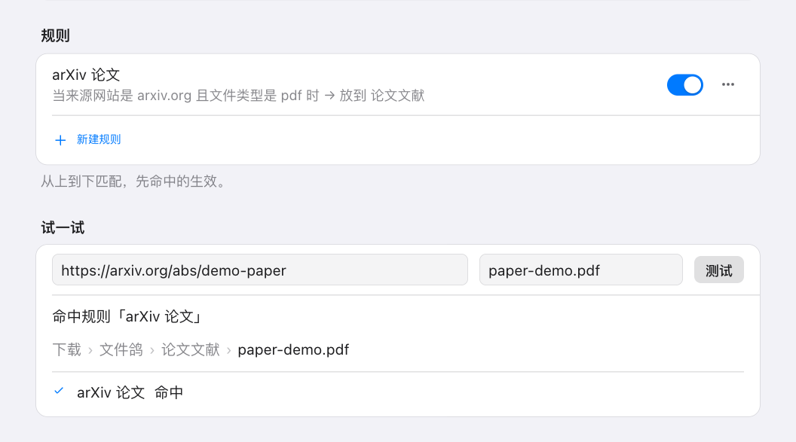

<h1 align="center"></h1>

在 Chrome 下载论文、采购附件或设计素材时，文件鸽会结合来源网页给文件起名，按规则、标签组或 AI 建议把它放进项目文件夹。

 
无需注册或填写 API Key · 公测期间内置 AI 每日限量免费

<a href="#功能一览">功能一览</a> · <a href="#界面导览">界面导览</a> · <a href="#归档规则示例">规则示例</a> · <a href="#第一次下载">第一次下载</a> · <a href="#常见问题">常见问题</a>

## 功能一览

| 下载时遇到的事 | 文件鸽能帮你做什么 |
| --- | --- |
| 同一页挂着好几个「附件」 | 开启「页面内容片段」并授权后，结合每个下载链接附近的文字分别起名。下次可以直接搜「评分细则」或「合同模板」。 |
| 一个项目的资料散在好几个网站 | 用浏览器标签组把它们归进同一项目，也可以用规则固定去向，或让 AI 建议。没有匹配项目时按来源网站归类。 |
| 指定网站的原始编号必须保留 | 在「不改名的网站」中添加该站点。文件仍可归档，交材料时能对上对方的原始文件名。 |
| 想知道刚才的文件去了哪里 | 在「最近」里看文件名、所属项目和撤销选项。遇到归得合适的一份，可以从这条记录为同类下载建规则。 |

<picture>
  <source media="(prefers-reduced-motion: reduce)" srcset="media/download-demo-still.png">
  
</picture>

## 界面导览

以下界面使用示例文件和项目。点开图片可查看原图。

### 同一份公告，每个附件都有自己的名字

采购公告页上同时挂着采购需求书、评分细则和合同模板。文件鸽能利用网页提供的附件线索，把项目名和材料名一起保留下来。开会前在「青禾采购」里搜「评分细则」，就能直接找到要讨论的 PDF。

展开 Chrome 商店原图，看公告中的三个附件与保存结果

### 从最近记录找回下载

打开工具栏里的文件鸽，进入「最近」。图中三份附件都进了「青禾采购」，第一行还保留着「撤销」入口。这一批都需要还原时，可以用「撤销本批」。需要在本机移动文件时，浏览器会提示授权。

### 把这次的去向记成下次的规则

一次采购可能持续好几周。在归得合适的那条记录上选「更多 → 以后同类都这样」，来源、文件类型和项目就会带入规则编辑器。下面这条规则只收指定来源的 PDF，同网站的其他文件仍按各自的情况处理。检查后点「保存」，后续匹配的下载才会使用它。

看规则编辑器里的来源、文件类型和目标项目

## 归档规则示例

在「项目与规则」里先建一个项目，例如把「论文文献」放到 `毕业论文/文献`。项目文件夹最多支持两层，还可以填写相关网站、标签组和给 AI 参考的一句话描述。

点「新建规则」，用「加条件」要求几项同时满足，比如既来自某个网站，又是 PDF。多条规则重叠时，列表中排在前面的先匹配。你可以用「上移」「下移」调整顺序。

| 如果你在做这件事 | 可以这样设 |
| --- | --- |
| **写文献综述**，把论文和同站的其他下载分开 | 选「来源网站是」填 `arxiv.org`，再加「文件类型是」填 `pdf`，归入自己的「论文文献」项目。 |
| **筹备展览或收集 AI 创作素材**，参考图、平面图和印刷规格来自不同网站 | 给这些网页建一个「春季展览」标签组，使用「标签组是」来匹配。以后从组内网页下载，文件就有共同的去向。 |
| **整理月报与票据**，回头要按业务名称和日期查找 | 对标题或网址包含「客流月报」的下载指定「经营月报」项目，并在这条规则的「文件名」中选「日期在前」。 |
| **投标或交付**，文件要归档但不能丢掉对方的交付编号 | 在对应的来源规则里指定项目，把「文件名」选成「不改名」。同样适合需要按原编号提交的报名表或办事材料。 |

### 先测试一条规则，再用它收文件

打开「项目与规则 → 试一试」。选一条最近的下载，或填入网址和文件名，点「测试」就能看到哪条规则命中、其余规则为什么没命中。图中用 `paper-demo.pdf` 试算，结果显示「命中规则『arXiv 论文』」，预计放进 `下载/文件鸽/论文文献`。如果去向不对，可以改完条件再测，全程无需重新下载文件。

同一个网站同时服务两个项目，该按网站还是按标签组归档？

比如你正准备两门课，讲义都出自同一教务网站。可以把网页分别放进「统计学」「城市规划」两个浏览器标签组，各建一条按组匹配的规则。如果还有一条覆盖整个教务网站的规则，把两条更具体的规则移到它上面。用最近的一次下载在「试一试」里检查优先级即可。

## 第一次下载

1. 从 Chrome 应用商店安装文件鸽，打开一篇带多个附件的课程通知或公告。要分别识别同页附件，在设置中开启「页面内容片段」并按提示授权。
2. 像平常一样点网页上的下载链接。选一个叫「附件1」的文件，看看保存后的名字。
3. 点工具栏里的文件鸽，进入「最近」查看文件去了哪。如果下次还想这样整理，可以从这条记录创建规则。

## 常见问题

<strong>能先看看论文、公告和图片会怎么命名吗？</strong>

可以。在「命名与 AI」的命名示例中切换「论文」「公告」「图片」，对照原名和处理后的名字。例如，论文详情页的题目能给编号式 PDF 提供线索，作品页的标题能给相机流水号或 `image.png` 提供线索。

<strong>哪些信息会发给 AI？会上传 PDF、图片或表格内容吗？</strong>

文件内容不会上传。AI 会使用网页标题、处理过的网址、原文件名等命名和归档所需的信息。开启「页面内容片段」并授权后，下载链接附近的文字和网页开头的一小段文字也可发送给 AI。设置和处理记录保存在本机，匿名使用统计可在设置中关闭。[文件鸽隐私政策](https://pigeonhole.tmlab.top/privacy?lang=zh)

<strong>我只想临时停用，或少收一点通知，怎么设置？</strong>

在「通用」里把「结果通知」改成「只在要确认时」。临时下载一批无需整理的文件时，可以选择「暂停 1 小时」或「暂停到今天结束」。

<strong>需要注册或购买 API Key 吗？能用自己的模型服务吗？</strong>

无需注册。内置 AI 在公测期间提供每日免费额度。想使用自己的兼容 AI 服务，也可以在设置中填写对应的 API Key、服务地址和模型。

本仓库仅公开[文件鸽 Lite 版](docs/lite.md)的源码，完整版可从 [Chrome 应用商店下载安装](https://chromewebstore.google.com/detail/pigeonhole/ikjdcjgnlbealhahlogjidahhhlbcdhp?hl=zh-CN)。
