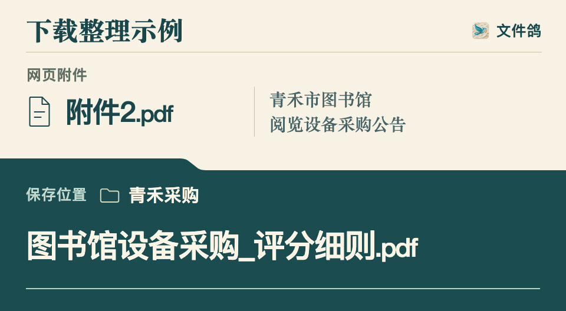

<h1 align="center">文件鸽 · Pigeonhole</h1>

<strong>在 Chrome 下载文件时，自动给附件起名，放进对应的项目文件夹。</strong>

   
  无需注册或填写 API Key · 内置 AI 公测期间每日限量免费

<picture>
  <source media="(prefers-reduced-motion: reduce)" srcset="media/download-demo-still.png">
  
</picture>

## 同一份公告，三个附件各有名字

采购公告上写着「采购需求书」「评分细则」「合同模板」，下载链接却叫 `附件1.pdf`、`附件2.pdf` 和 `附件3.docx`。授权文件鸽使用下载链接附近的文字后，它就有了区分这三份材料的线索。下次开评审会，直接在项目文件夹里搜「评分细则」就能找到那份 PDF。[查看 Chrome 商店原图](media/store-attachments.png)

## 多个网站的资料，放进同一个项目

假设你在筹备春季展览。印厂的出血规格、场馆的平面图、设计师的海报分别来自三个网站。把这些网页放进「春季展览」标签组，文件鸽就可以按组归档。你也可以给常用来源设规则，或让 AI 建议去向。没有匹配的项目时，文件会按来源网站归类。

## 哪些下载最省整理时间？

- **论文和课件**　论文 PDF 往往只有编号。论文详情页的题目能用来命名，课程标签组还能把讲义、习题和参考文献集中起来。
- **设计和 AI 创作素材**　从不同作品页保存的图都叫 `image.png` 时，用作品标题给配图命名，排版时就能按主题找。
- **月报和差旅票据**　导出页的标题里有「四月客流」或行程名称时，这些文字可以成为 CSV 或电子发票的文件名，核对时更好搜。
- **求职、办事和旅行**　一次申请往往要从不同网站下载报名表、材料清单和路线图。按事项归档，下次补材料时打开一个文件夹就能接着办。

## 安装后，试一次下载

1. 打开一篇带附件的公告或课程详情页。如果想区分同一页的多份附件，先在文件鸽设置里开启「页面内容片段」，按浏览器提示授权。
2. 像平常一样点击网页上的下载链接。可以挑一个叫「附件1」或只有编号的文件，看看保存时它得到了什么名字。
3. 点击工具栏里的文件鸽，查看最近记录中的文件名和去向。放错项目可以更换文件夹，也可以撤销改名。需要移动文件时，浏览器会请你授权目标文件夹。

<strong>AI 命名和归档会用到哪些数据？</strong>

文件内容不会上传。AI 根据网页标题、处理过的网址和原文件名等信息给出建议。开启「页面内容片段」并授权后，还会使用网页开头的一小段文字和下载链接附近的文字。设置和处理记录保存在本机，匿名使用统计可在设置中关闭。

<strong>要自己买 API Key 吗？</strong>

安装后即可使用内置 AI，公测期间有每日免费额度。已有兼容 AI 服务的用户也可以在设置中接入自己的 API Key。

本仓库仅公开[文件鸽 Lite 版](docs/lite.md)的源码，完整版可从 [Chrome 应用商店下载安装](https://chromewebstore.google.com/detail/pigeonhole/ikjdcjgnlbealhahlogjidahhhlbcdhp?hl=zh-CN)。
